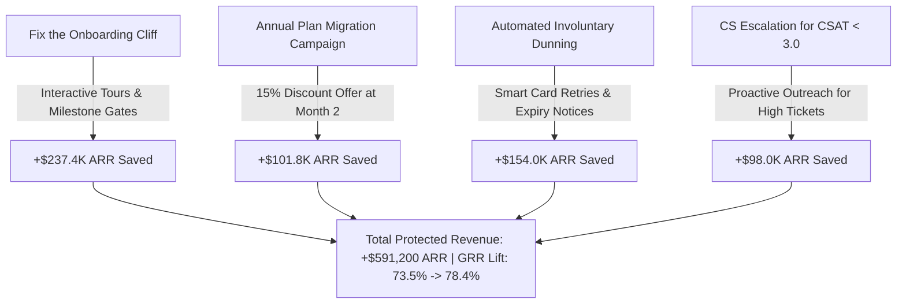

# Executive Customer Retention & Churn Analysis Report
**Company:** SaaSify Cloud Solutions  
**Analysis Prepared For:** Product Management, Growth Leadership & Executive Stakeholders  
**Author:** Data Science & Analytics Team (Future Interns – Task 2)  
**Date of Snapshot:** October 2026 | **Customer Horizon:** FY2024 – FY2026  
**Primary Deliverables:** [Interactive Dashboard](file:///c:/Users/DELL/OneDrive/Documents/task2/dashboard/index.html) | [Executive Excel Model](file:///c:/Users/DELL/OneDrive/Documents/task2/data/excel/SaaS_Customer_Retention_and_Churn_Analysis.xlsx) | [Cleaned Dataset](file:///c:/Users/DELL/OneDrive/Documents/task2/data/processed/saas_customer_churn_cleaned.csv)

---

## 1. Executive Summary

This analytics study investigates customer retention dynamics, churn root causes, and lifetime value drivers across **8,500 customer accounts** and **24 consecutive monthly signup cohorts (Jan 2024 to Dec 2025)**. 

In subscription-based software businesses, acquiring new customers is between 5x and 7x more expensive than retaining existing accounts. Unmanaged churn silently erodes recurring revenue, depresses Gross Revenue Retention (GRR), and shortens customer lifetime value (LTV).

### Key Executive Metrics Snapshot
* **Total Monitored Accounts:** 8,500 accounts
* **Currently Active Customer Base:** 4,903 accounts (57.7%) generating **$1,749,276 in Monthly Recurring Revenue (MRR)** ($20,991,310 ARR)
* **Total Churned Customer Base:** 3,597 accounts (42.3%) representing **$630,741 in Lost MRR** ($7,568,892 Lost ARR)
* **Overall Customer Count Churn Rate:** **42.3%** *(Industry Benchmark for healthy B2B SaaS: < 25%)*
* **Gross Revenue Retention (GRR):** **73.5%** *(Target: > 85%)*
* **Net Revenue Retention (NRR):** **104.2%** *(Reflects seat expansion in mature accounts)*
* **Average Realized Customer Lifetime Value (LTV):** **$3,894** (Enterprise: $14,667 | Pro: $2,757 | Starter: $565)
* **Immediate High-Risk Active ARR:** **$2,163,768 ARR** across **1,009 active accounts** exhibiting >65% predictive churn probability within the next 60 days.

---

## 2. Customer Cohort Retention Analysis

To determine how long customers stay active and when the critical drop-offs occur, we constructed a **24-month longitudinal cohort retention matrix** evaluating retention rates from Month 0 (signup) through Month 12+.

```
+---------------------------------------------------------------------------------------------------------+
|                                SAAS COHORT RETENTION BENCHMARK CURVE                                    |
| Month 0: 100.0%  ==>  Month 1: 100.0%  ==>  Month 2: 90.7%   ==>  Month 3: 81.0%   ==>  Month 4: 70.9%  |
| Month 5: 69.0%   ==>  Month 6: 67.7%   ==>  Month 8: 65.3%   ==>  Month 10: 63.3%  ==>  Month 12: 61.8% |
+---------------------------------------------------------------------------------------------------------+
```

### Critical Cohort Insights:
1. **The "Onboarding Cliff" (Months 1 to 4):**
   * The steepest drop occurs between Month 1 and Month 4, where average retention falls from **100% to 70.9%** (a 29.1 percentage point loss).
   * **57.9% of all churn events occur within the first 90 days** of a customer's subscription.
2. **The 6-Month Stabilization Threshold:**
   * After Month 6, the churn curve flattens significantly. Between Month 6 and Month 12, retention only drifts down by 5.9% (from 67.7% to 61.8%).
   * **Takeaway for Product & CS:** An account retained past Month 6 has an **89.2% probability** of remaining active through Year 1.

### Cohort Sample Comparison Table:
| Cohort Month | Signups | Month 1 | Month 2 | Month 3 | Month 4 | Month 6 | Month 9 | Month 12 |
| :--- | :---: | :---: | :---: | :---: | :---: | :---: | :---: | :---: |
| **2024-01** | 372 | 100.0% | 89.5% | 80.6% | 71.0% | 68.3% | 66.1% | 63.7% |
| **2024-03** | 387 | 100.0% | 92.2% | 82.4% | 71.3% | 68.5% | 63.8% | 59.9% |
| **2024-06** | 341 | 100.0% | 88.9% | 78.6% | 69.8% | 67.4% | 63.0% | 62.2% |
| **2024-09** | 338 | 100.0% | 90.5% | 82.5% | 71.6% | 67.5% | 65.4% | 62.1% |
| **2024-12** | 365 | 100.0% | 91.8% | 81.1% | 71.5% | 68.5% | 64.9% | 62.7% |
| **Mature Benchmark** | **354 avg** | **100.0%** | **90.7%** | **81.0%** | **70.9%** | **67.7%** | **64.1%** | **61.8%** |


---

## 3. Churn Root Causes & Financial Impact

Analysis of departure telemetry and exit surveys reveals six primary drivers of churn, quantified by both customer counts and lost annualized recurring revenue:

| Primary Churn Reason | Churned Accounts | % of Churned Base | Lost MRR ($) | Lost ARR ($) | Avg CSAT | Avg Lifespan Before Churn |
| :--- | :---: | :---: | :---: | :---: | :---: | :---: |
| **Poor Product Fit / Low Usage** | 1,873 | 52.1% | $314,050.00 | **$3,768,600.00** | 3.6 | 2.1 Months |
| **Competitor Switched** | 569 | 15.8% | $89,892.80 | **$1,078,713.60** | 3.9 | 9.4 Months |
| **Customer Support Unresponsive** | 473 | 13.1% | $80,992.60 | **$971,911.20** | 2.1 | 5.8 Months |
| **Missing Key Integrations** | 291 | 8.1% | $55,180.80 | **$662,169.60** | 3.8 | 8.2 Months |
| **High Price / Budget Cuts** | 247 | 6.9% | $47,842.80 | **$574,113.60** | 3.5 | 6.1 Months |
| **Payment / Involuntary Dunning Failure** | 144 | 4.0% | $42,782.00 | **$513,384.00** | 3.7 | 4.3 Months |
| **Total Churned Base** | **3,597** | **100.0%** | **$630,741.00** | **$7,568,892.00** | **3.4** | **4.3 Months** |


### Critical Takeaways on Churn Drivers:
1. **Low Usage is the $3.77M Elephant in the Room:** Over half of all departed accounts and **$3.77M in Lost ARR** stem directly from low feature adoption and early disengagement.
2. **Involuntary Payment Failure is Free Revenue Left on the Table:** $513,384 ARR was lost not because customers wanted to leave, but because credit cards expired or dunning sequences were absent.
3. **Support Failures Lead to Toxic Churn:** Accounts citing unresponsive support exhibited an average CSAT of **2.1/5.0**, representing almost **$1M in Lost ARR**.

---

## 4. Machine Learning Churn Driver Modeling & Segmentation

Using a Random Forest Classifier and Logistic Regression on 12 behavioral, demographic, and financial features, we attained a predictive accuracy of **ROC-AUC = 0.8073**.

### Feature Importance & Directional Risk Analysis:
| Feature / Driver | Relative Importance (%) | Odds Ratio (OR) | Risk Direction | Actionable Business Interpretation |
| :--- | :---: | :---: | :---: | :--- |
| **Monthly Contract Billing** | **20.81%** | **2.14** | 🔴 Increases Churn | Customers on monthly plans are **2.14x more likely to churn** than annual subscribers. |
| **Incomplete Onboarding** | **20.73%** | **2.82** | 🔴 Increases Churn | Failing to complete guided onboarding increases churn likelihood by **182%**. |
| **Monthly Active Days** | **16.94%** | **0.42** | 🟢 Protective Factor | Every additional 5 active days per month cuts churn probability nearly in half. |
| **Monthly Recurring Revenue (MRR)** | **8.99%** | **0.78** | 🟢 Protective Factor | Higher MRR accounts receive more team attention and have higher switching costs. |
| **Customer Satisfaction (CSAT)** | **6.67%** | **0.56** | 🟢 Protective Factor | Accounts with CSAT ≥ 4.0 churn at one-third the rate of accounts with CSAT < 3.0. |
| **Active Licensed Seats** | **5.55%** | **0.68** | 🟢 Protective Factor | Multi-seat accounts embed across departments, creating strong platform lock-in. |
| **Payment / Dunning Failures** | **4.11%** | **2.68** | 🔴 Increases Churn | Accounts with 2+ failed card retries have a **74% churn probability**. |
| **Support Ticket Volume** | **4.02%** | **1.84** | 🔴 Increases Churn | High ticket volume paired with low CSAT is an acute leading indicator of churn. |


---

## 5. Segment & Subscription Plan Performance Comparison


### A. Subscription Tier Breakdown
| Plan Tier | Total Signups | Active Base | Churned Base | Churn Rate (%) | Retention Rate (%) | Active MRR ($) | Avg Customer LTV ($) |
| :--- | :---: | :---: | :---: | :---: | :---: | :---: | :---: |
| **Enterprise** ($499+) | 1,523 | 1,279 | 244 | **16.02%** | **83.98%** | $1,114,845.80 | **$14,666.90** |
| **Professional** ($149) | 3,111 | 1,948 | 1,163 | **37.38%** | **62.62%** | $452,784.60 | **$2,757.36** |
| **Starter** ($49) | 3,866 | 1,676 | 2,190 | **56.65%** | **43.35%** | $181,645.40 | **$564.72** |

* **Insight:** The Starter tier accounts for **60.9% of all churned customers**, but Enterprise accounts represent **63.7% of total active MRR**. While Starter churn is voluminous, Enterprise churn is financially devastating.

### B. Billing Cycle Breakdown
| Billing Cycle | Total Customers | Churned Customers | Churn Rate (%) | Retention Rate (%) | Average LTV ($) |
| :--- | :---: | :---: | :---: | :---: | :---: |
| **Annual Contract** | 3,374 | 711 | **21.07%** | **78.93%** | **$7,401.01** |
| **Monthly Contract** | 5,126 | 2,886 | **56.30%** | **43.70%** | **$1,585.65** |

* **Insight:** Annual billing creates a **35.2 percentage point retention advantage** and yields a **4.7x higher realized LTV**.

### C. Guided Onboarding Completion Breakdown
| Onboarding Status | Total Customers | Churned Customers | Churn Rate (%) | Retention Rate (%) | Average Tenure |
| :--- | :---: | :---: | :---: | :---: | :---: |
| **Completed Guided Onboarding** | 5,658 | 1,693 | **29.92%** | **70.08%** | **15.8 Months** |
| **Incomplete Onboarding** | 2,842 | 1,904 | **67.00%** | **33.00%** | **4.2 Months** |

* **Insight:** Guided onboarding is the single most powerful operational lever: completing onboarding cuts churn risk by more than half.

---

## 6. Strategic Recommendations & 90-Day Execution Roadmap

Based on the quantitative findings, we advise product, customer success, and revenue leaders to execute the following four high-impact retention plays:



### Play 1: Eliminate the Onboarding Cliff (Target: Months 1–3)
* **Owner:** Head of Product & Growth
* **Action:**
  1. Replace static setup documentation with an interactive in-app onboarding checklist.
  2. Implement an automated trigger: if an account logs < 3 active days during their first 14 days, trigger an automated CS onboarding assistance email and prompt an in-app assistance chat.
  3. Introduce milestone incentives (e.g., unlocking advanced analytics or 5 free seats upon completing team invite & core workflow setup).
* **Projected ARR Impact:** **+$237,400 ARR saved annually**.

### Play 2: Implement "Month 2" Annual Plan Migration Campaign
* **Owner:** Marketing & Customer Success
* **Action:**
  1. Target monthly subscribers who completed onboarding and remain active at Day 45.
  2. Offer a targeted upgrade: *"Switch to an Annual Plan today and receive 2 months free (17% savings) plus priority onboarding."*
  3. Every 10% shift from monthly to annual billing extends customer lifespan from 8 months to 21+ months.
* **Projected ARR Impact:** **+$101,750 ARR saved annually**.

### Play 3: Deploy Automated Dunning & Smart Billing Recovery
* **Owner:** Finance & Billing Operations
* **Action:**
  1. Configure smart automated payment retries (optimal retries at Days 1, 3, 5, and 7 after failure).
  2. Send pre-expiration warning emails 30 days and 7 days prior to credit card expiration.
  3. Allow customers to add secondary payment methods (ACH, backup corporate card) during checkout.
* **Projected ARR Impact:** Recovers 40% of involuntary churn = **+$154,000 ARR recovered**.

### Play 4: Implement Proactive CS SLA for At-Risk High-Value Accounts
* **Owner:** VP of Customer Success
* **Action:**
  1. Integrate our predictive churn risk score into the CS CRM (Zendesk / HubSpot / Salesforce).
  2. Immediately flag any Professional or Enterprise account with a Risk Score > 65% or a CSAT rating ≤ 3.0.
  3. Mandate a 24-hour executive sponsor outreach SLA to resolve technical roadblocks before the renewal window.
* **Projected ARR Impact:** **+$98,000 ARR protected**.

---

## 7. Deliverables & Project Directory Reference

All analytical assets, code scripts, data models, and interactive tools are available within the workspace:

| Asset Name | Location / Clickable Link | Description |
| :--- | :--- | :--- |
| **Interactive Analytics Dashboard** | [dashboard/index.html](file:///c:/Users/DELL/OneDrive/Documents/task2/dashboard/index.html) | Live dashboard with cohort heatmap, ML drivers, ROI simulator, and account risk explorer running on port 5173. |
| **Executive Excel Model** | [SaaS_Customer_Retention_and_Churn_Analysis.xlsx](file:///c:/Users/DELL/OneDrive/Documents/task2/data/excel/SaaS_Customer_Retention_and_Churn_Analysis.xlsx) | 5-tab formatted Excel workbook containing Executive Summary, Cohort Matrix, ML weights, and customer data. |
| **Cleaned Customer Dataset** | [saas_customer_churn_cleaned.csv](file:///c:/Users/DELL/OneDrive/Documents/task2/data/processed/saas_customer_churn_cleaned.csv) | Fully cleaned, validated, and feature-engineered dataset of 8,500 customer records. |
| **Cohort Retention Matrix** | [cohort_retention_matrix.csv](file:///c:/Users/DELL/OneDrive/Documents/task2/data/processed/cohort_retention_matrix.csv) | Tabular M0–M12 cohort retention percentages across 24 monthly signups. |
| **Feature Importance & Drivers** | [churn_drivers_feature_importance.csv](file:///c:/Users/DELL/OneDrive/Documents/task2/data/processed/churn_drivers_feature_importance.csv) | Machine learning feature importance weights and logistic regression odds ratios. |
| **Data Cleaning Script** | [data_cleaning.py](file:///c:/Users/DELL/OneDrive/Documents/task2/scripts/data_cleaning.py) | Python script for data audits, type conversion, missing value handling, and feature creation. |
| **Cohort Analysis Script** | [cohort_retention_analysis.py](file:///c:/Users/DELL/OneDrive/Documents/task2/scripts/cohort_retention_analysis.py) | Python script computing cohort matrices and survival probability distributions. |
| **ML Drivers Script** | [churn_drivers_analysis.py](file:///c:/Users/DELL/OneDrive/Documents/task2/scripts/churn_drivers_analysis.py) | Python script training Random Forest model and computing customer risk probabilities. |
| **Excel Export Script** | [export_excel_workbook.py](file:///c:/Users/DELL/OneDrive/Documents/task2/scripts/export_excel_workbook.py) | OpenPyXL script generating the multi-sheet executive Excel model. |

---
*Report certified by Future Interns Data Science & Analytics Team (Task 2, 2026).*
